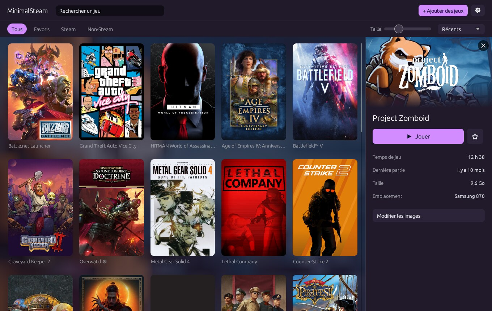
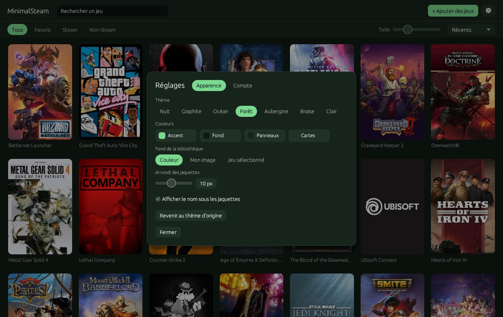

# MinimalSteam

**Tes jeux, et rien d'autre. Un lanceur léger et personnalisable pour tes jeux Steam et non-Steam sous Linux.**

Steam, c'est un magasin, une communauté, des actualités, des recommandations… alors que la plupart du temps, on veut juste lancer un jeu. MinimalSteam affiche ta bibliothèque dans une fenêtre épurée, sans compte à connecter : il lit directement les fichiers locaux de Steam.


## Fonctionnalités

- **Tes jeux installés et non-Steam** réunis dans une seule grille, sans Proton ni les autres outils de Steam.
- **Recherche, favoris et tri** par date, nom ou temps de jeu.
- **Fiche de jeu** : temps de jeu, dernière partie, taille, disque et version de Proton.
- **Lancement** en un double-clic, avec le bouton Jouer, la touche Entrée ou la manette.
- **Ajout rapide de jeux non-Steam**, sans passer par Steam.
- **Images modifiables** depuis [SteamGridDB](https://www.steamgriddb.com/) : couverture, bannière, arrière-plan, logo et icône.
- **Apparence à ton goût** : thèmes, couleurs, fond, arrondi et taille des jaquettes.
- **Mises à jour intégrées** depuis les releases GitHub.



## Ajouter des jeux non-Steam

Clique sur **Ajouter des jeux**, puis au choix :

- **Choisir des fichiers** : sélectionne un ou plusieurs `.exe`, AppImage ou programmes Linux.
- **Scanner un dossier** : indique ton dossier de jeux. MinimalSteam cherche le programme principal de chaque sous-dossier et écarte les installateurs, désinstalleurs et outils annexes.

Vérifie les noms, choisis la version de Proton pour les jeux Windows, puis valide. Les images sont récupérées automatiquement et Steam ne redémarre qu'une fois, sans afficher sa fenêtre, quel que soit le nombre de jeux.


## Personnalisation

- **7 thèmes** : Nuit, Graphite, Océan, Forêt, Aubergine, Braise et Clair.
- **Couleurs libres** pour l'accent, le fond, les panneaux, les cartes, le haut et le texte.
- **Police d'écriture** au choix parmi celles installées sur ton PC.
- **Fond du haut, de la bibliothèque et du panneau du jeu**, réglés séparément (le haut peut aussi être transparent) : une couleur, ton image, l'arrière-plan flouté du jeu sélectionné, celui d'un jeu choisi dans la liste, ou un fond haute définition de SteamGridDB, avec flou et assombrissement réglables. Le haut peut devenir un verre dépoli qui floute les jaquettes passant dessous.
- **Taille des jaquettes** réglable directement depuis la barre d'outils.
- **Arrondi des jaquettes** et affichage ou non des noms.

| Grandes jaquettes | Petites jaquettes |
|---|---|
|  |  |

| Thème clair | Réglages |
|---|---|
|  |  |


## Installation

1. Télécharge `MinimalSteam-x.y.z-linux-x86_64.AppImage` depuis les [Releases](https://github.com/VGioM/MinimalSteam/releases/latest).
2. Rends-la exécutable (clic droit, Propriétés, « Exécutable », ou `chmod +x MinimalSteam-*.AppImage`), puis lance-la.
3. Pour modifier les images, ajoute une **clé API SteamGridDB** gratuite dans **Réglages, Compte**. Tu peux l'obtenir sur [la page API de SteamGridDB](https://www.steamgriddb.com/profile/preferences/api).

Steam doit être installé (version native ou Flatpak) et connecté à ton compte.

## Raccourcis

| Action | Clavier | Manette |
|---|---|---|
| Se déplacer | Flèches | Croix ou stick gauche |
| Lancer le jeu | Entrée ou double-clic | A |
| Fermer la fiche | Échap | B |
| Favori | | Y |
| Rechercher | Ctrl+F | |

La manette est ignorée quand la fenêtre n'a pas le focus ou qu'un jeu tourne.

## Comment ça marche

Steam reste nécessaire pour les DRM, Steam Cloud, les succès et Proton. MinimalSteam lui demande de lancer les jeux et, s'il est fermé, le démarre sans fenêtre. Tes réglages de Proton et options de lancement restent donc ceux de Steam.

L'app ne modifie les fichiers de Steam que pour ajouter un jeu ou appliquer une icône :

| Fichier | Rôle |
|---|---|
| `userdata/<compte>/config/shortcuts.vdf` | Jeux non-Steam et icônes |
| `config/config.vdf` | Version de Proton des jeux ajoutés |
| `userdata/<compte>/config/grid/` | Images personnalisées |

Ces écritures se font Steam fermé et **jamais pendant qu'un jeu tourne**. Tu peux ajouter un jeu ou changer de Proton en pleine partie : le changement passe en **file d'attente**, puis Steam redémarre discrètement quelques secondes après la fermeture du dernier jeu. Une copie `*.minimalsteam-sauvegarde` est créée avant la première modification. Les réglages de l'app sont dans `~/.config/Minimalsteam/`.

## Limites

- Seuls les jeux **installés** sont affichés. L'installation d'un jeu se fait toujours dans Steam.
- MinimalSteam ne gère pas les ROM ni les émulateurs.

## Remplace Biblijeu sur Linux

MinimalSteam prend la suite de la version Linux de [Biblijeu](https://github.com/VGioM/Biblijeu), qui reste une application macOS.

## Compiler

```sh
cargo build --release
```

Il faut Rust et les bibliothèques de développement X11/Wayland habituelles. `./build-appimage.sh` produit l'AppImage (avec `squashfs-tools` et un runtime AppImage).

## Licence

[MIT](LICENSE)
