# MinimalSteam

**Tes jeux, et rien d'autre. Un lanceur léger et personnalisable pour tes jeux Steam et non-Steam sous Linux.**

Steam, c'est un magasin, une communauté, des actualités, des recommandations… alors que la plupart du temps, on veut juste lancer un jeu. MinimalSteam affiche ta bibliothèque dans une fenêtre épurée, sans compte à connecter : il lit directement les fichiers locaux de Steam.

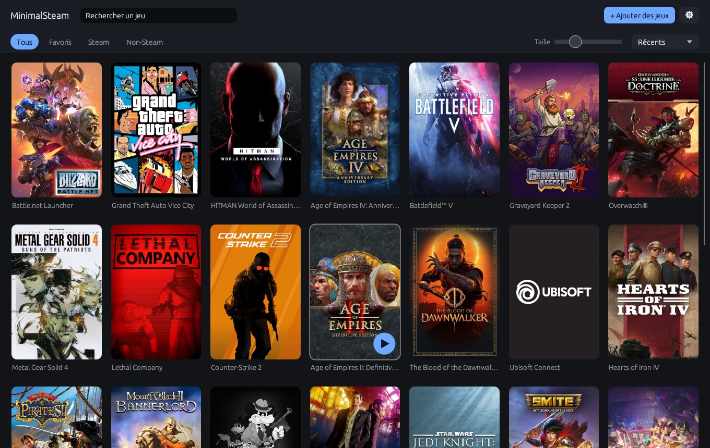

## Fonctionnalités

- **Tes jeux installés et non-Steam** réunis dans une seule grille, sans Proton ni les autres outils de Steam.
- **Recherche, favoris et tri** par date, nom ou temps de jeu.
- **Grille ou liste** : jaquettes de toutes tailles jusqu'aux simples icônes, ou une ligne par jeu avec temps de jeu, dernière partie et emplacement.
- **Onglets et barre à ta main** : dans Réglages > Affichage, choisis les onglets à montrer et glisse-les pour changer leur ordre ; les options de tri, taille et vue peuvent rester dans la barre, tenir dans un bouton « Affichage » ou disparaître. La fenêtre s'adapte quand elle est étroite : les onglets en trop passent dans un menu « Plus ».
- **Fiche de jeu** : temps de jeu, dernière partie, taille, disque, version de Proton et **description en français** (celle de Steam, ou la fiche du magasin Steam trouvée par le nom pour un jeu non-Steam ; si Steam n'a que de l'anglais, le résumé de l'article Wikipédia en français), modifiable si ce n'est pas la bonne.
- **Carte graphique selon le jeu** (NVIDIA, option à activer) : une limite de watts et un palier d'overclocking (d'origine, prudent, courant, élevé) par jeu, appliqués au lancement et remplacés par le réglage par défaut à la fermeture. Mêmes conseils que [PowerCap](https://github.com/VGioM/PowerCap) : perte d'images/s estimée, MHz adaptés aux watts, bilan par rapport à la carte d'origine. Tout se gère aussi dans Réglages > Carte graphique (réglage par défaut et liste des jeux réglés). Une autorisation installée une fois (mot de passe demandé) permet ensuite de changer sans mot de passe. **AMD et Intel ne sont pas encore pris en charge** : avec une de ces cartes, laisse l'option décochée.
- **Onglet Statistiques** : pour chaque jeu, le temps total, le temps joué chaque jour de la semaine en cours, de la semaine dernière et du mois, les dernières parties, la plus longue, la série de jours joués, et les **succès Steam** débloqués (avec leur date) ou à débloquer (avec la part des joueurs qui les ont). Un clic sur un jour ouvre son détail : une frise heure par heure avec chaque partie à sa place, et le temps passé sur chaque jeu. Le graphique du mois remonte aux mois précédents, et celui des 12 mois d'année en année : rien n'est effacé tout seul. Tu peux effacer l'historique de mois précis (cochés un par un, dans Données) sans toucher au temps total de Steam. Un **rapport** sur la période de ton choix (7 jours, 30 jours, un mois, 12 mois ou depuis le début) montre la répartition du temps par jeu, les heures de la journée et les jours de la semaine où tu joues, l'évolution sur 12 mois et un calendrier d'activité sur 6 mois. Sur la vue d'ensemble, chaque barre est découpée par jeu, avec le détail au survol. Les heures de la journée se voient en total, en moyenne par jour ou pour aujourd'hui ; un clic sur une heure ou un jour de la semaine montre les jeux joués à ce moment-là et les dernières parties. Le rapport s'affiche en chiffres, en camembert ou en classement, se compare à la période d'avant, et une carte **Records** garde la plus longue partie, le meilleur jour, la plus longue série, le meilleur mois et la fin la plus tardive. La liste des succès se replie, se limite aux premiers et se fouille avec une recherche. Une vue d'ensemble montre les mêmes chiffres pour tous tes jeux. Le bouton **Statistiques** sous **Jouer** ouvre directement celles du jeu.
- **Entrées regroupées** : plusieurs entrées non-Steam pour le même jeu (par exemple Prototype, Prototype 2 et Prototype Biohazard Bundle) peuvent compter leurs stats dans une seule, même après la suppression des autres.
- **Statistiques exportables** : elles sont rangées dans `~/.config/Minimalsteam/statistiques` avec une copie de secours par jour, s'exportent et s'importent sans doublon, et peuvent être copiées automatiquement dans le dossier de ton choix.
- **Lancement** en un double-clic, avec le bouton Jouer, la touche Entrée ou la manette.
- **Mode Big Picture** : plein écran, en gros, tout à la manette, au clavier ou à la souris, comme une console (voir [plus bas](#mode-big-picture)).
- **Souris cachée** après 5 secondes sans la bouger, aussi hors Big Picture (Réglages > Affichage) : dans la fenêtre de MinimalSteam, et si tu veux dans les jeux et les autres logiciels (KDE). Pour un jeu qui a son propre curseur, coche « Souris toujours visible pendant ce jeu » sur sa fiche.
- **Lancement au démarrage du PC** (Réglages > Compte ou > Big Picture). Si l'AppImage est sur un disque secondaire, MinimalSteam attend jusqu'à une minute qu'il soit monté.
- **Commandes à ta main** : dans Réglages > Commandes, deux touches de manette et deux touches de clavier ou de souris (molette, boutons de côté) par action. Toutes les manettes reconnues par Linux marchent (Xbox, PlayStation, 8BitDo…), en USB ou en Bluetooth, sticks et gâchettes compris.
- **Jeux non-Steam lancés sans Steam**, avec Proton et dans leur préfixe habituel, donc avec les mêmes sauvegardes.
- **AppImage et scripts `.sh`** ajoutés directement à MinimalSteam, sans passer par Steam.
- **Synchronisation avec Steam** : envoie un ou plusieurs programmes dans Steam, avec ou sans collection MinimalSteam, et range chaque jeu dans la collection ou retire-le depuis sa fiche.
- **Onglet Amis** : qui de tes amis Steam est en jeu (et à quoi), en ligne ou hors ligne (vu il y a…), actualisé chaque minute. Marque tes amis favoris d'une étoile et n'affiche qu'eux si tu veux. Chaque groupe (en jeu, en ligne, hors ligne) se replie d'un clic, par exemple pendant un stream. Avec la clé API Steam ; si ta liste d'amis Steam est privée, ce sont les comptes que Steam connaît sur ton PC, et tu peux masquer ceux qui ne sont plus tes amis.
- **Onglet Non installés** pour voir et installer les jeux que tu possèdes.
- **Onglet Lancés** pour voir et arrêter tout ce qui tourne, Steam ou non.
- **Jeux cachés** : cache un jeu depuis sa fiche, il ne s'affiche plus que dans l'onglet **Cachés**. Rien n'est changé dans Steam.
- **Suppression d'un jeu non-Steam** de ta bibliothèque Steam, depuis sa fiche. Les fichiers du jeu restent sur le disque.
- **Images modifiables** depuis [SteamGridDB](https://www.steamgriddb.com/) : couverture, bannière, arrière-plan, logo et icône.
- **Menu clic droit** sur chaque jaquette : jouer, favori, renommer, images, dossier, Proton, collection, cacher, supprimer…
- **Apparence à ton goût** : thèmes, couleurs, fond, arrondi et taille des jaquettes, avec le rendu **Lumière** (arrondi, reflets et halos) ou **Legacy** (plat).
- **Mises à jour intégrées** depuis les releases GitHub.


## Mode Big Picture

Pour jouer depuis le canapé comme sur une console : MinimalSteam passe en plein écran, en gros, et tout se fait à la **manette**, au **clavier** ou à la **souris**. Il s'ouvre avec le bouton **Big Picture** en haut de la fenêtre, **View** à la manette ou **F11**, et se ferme de la même façon.

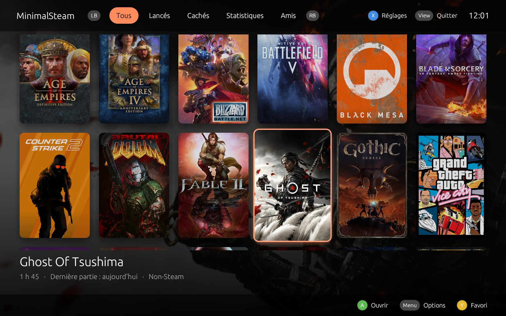

- **Bibliothèque** en grandes jaquettes, sur le fond du jeu choisi, avec ses onglets (LB / RB pour passer de l'un à l'autre), les Statistiques et les Amis.
- **Fiche du jeu** : jouer ou arrêter, favori, images, carte graphique, version de Proton, lancer via Steam, statistiques, dossier, cacher. LB / RB passent au jeu précédent ou suivant.
- **Menu d'options** (bouton Menu) sur n'importe quel jeu, sans ouvrir sa fiche.
- **Tous les réglages** se pilotent à la manette : un cadre montre l'élément choisi, A l'active, LB / RB changent d'onglet, l'affichage suit.
- **Aides de touches** en bas de l'écran, au nom des boutons de la manette ou des touches du clavier selon ce que tu utilises. Elles se cliquent aussi.
- **Souris cachée** après 5 secondes sans la bouger, ou dès que tu joues à la manette, et aussi dans les jeux et les autres logiciels (effet « Cacher le pointeur » de KDE, seulement pendant le Big Picture). Pour un jeu qui a son propre curseur, comme WoW, choisis « Souris pendant ce jeu : toujours visible » sur sa fiche.
- **Démarrage comme une console** : coche « Lancer MinimalSteam au démarrage du PC » et « Ouvrir MinimalSteam en Big Picture ».
- **Taille de l'interface** réglable (130 % par défaut), plein écran ou non. Le mode peut aussi être retiré complètement.

| Fiche d'un jeu | Menu d'options |
|---|---|
| 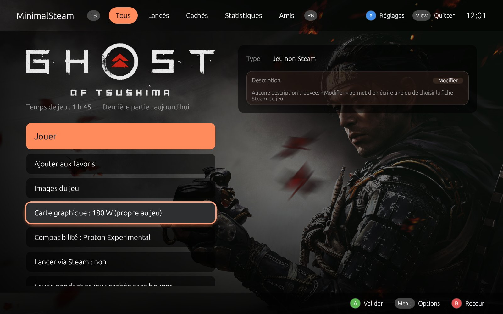 | 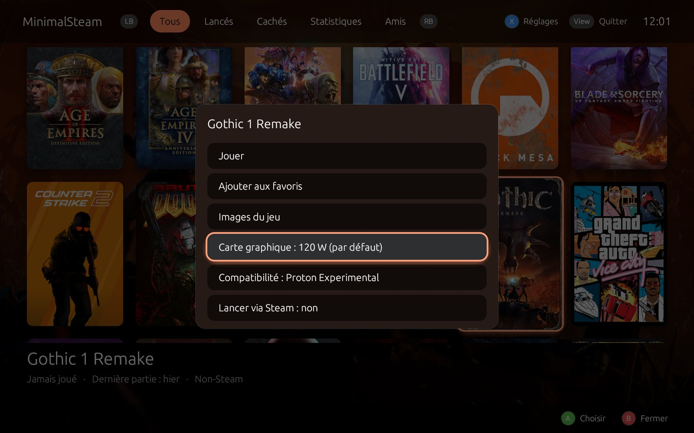 |

| Commandes à ta main | Réglages du Big Picture |
|---|---|
| 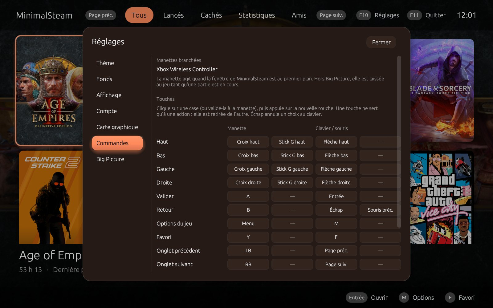 | 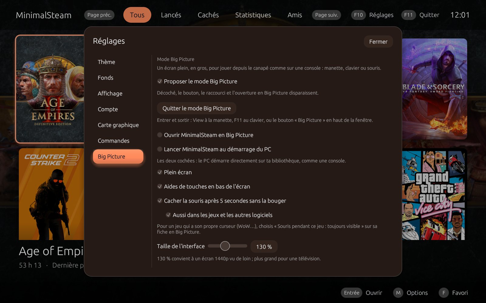 |

### Manettes et commandes

Toutes les manettes reconnues par Linux marchent, en USB ou en Bluetooth (Xbox, PlayStation, 8BitDo…), avec la croix, les deux sticks et les gâchettes. Une direction tenue se répète, et le stick droit fait défiler les pages. Dans **Réglages > Commandes**, chaque action a deux touches de manette et deux touches de clavier ou de souris (molette, boutons de côté) : clique sur une case, puis appuie sur la nouvelle touche. La manette marche aussi hors Big Picture.

## Statistiques, amis et carte graphique

| Statistiques | Amis |
|---|---|
| 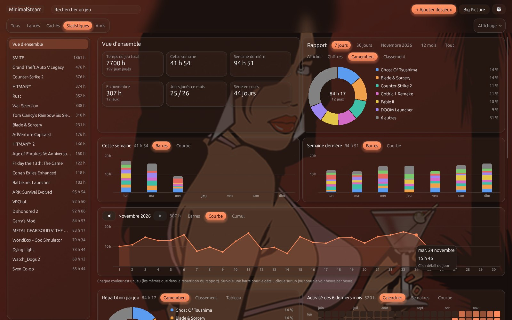 | 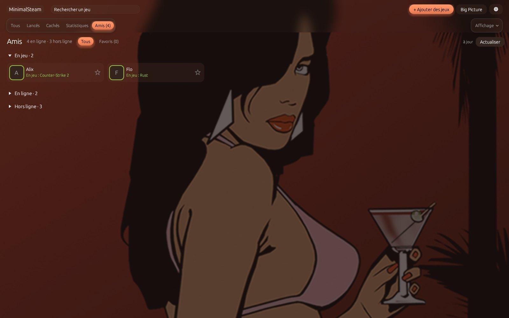 |

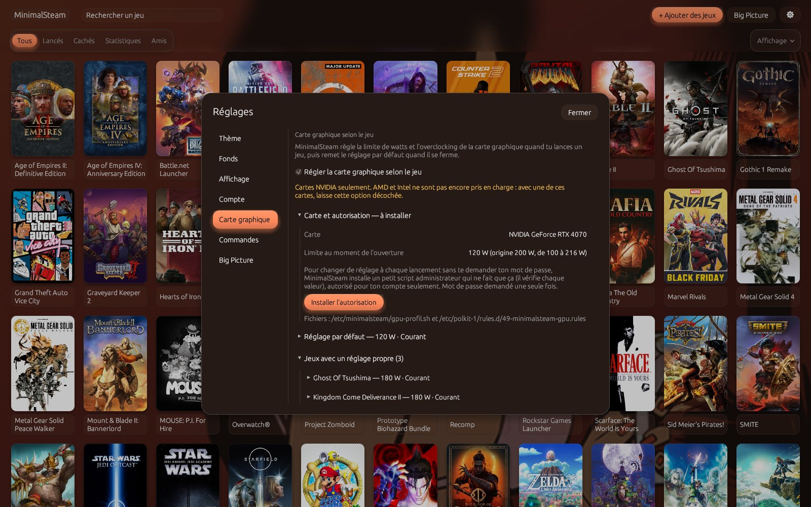

## Ajouter des jeux non-Steam

Clique sur **Ajouter des jeux**, puis au choix :

- **Choisir des fichiers** : sélectionne un ou plusieurs `.exe`, AppImage ou programmes Linux.
- **Scanner un dossier** : indique ton dossier de jeux. MinimalSteam cherche le programme principal de chaque sous-dossier et écarte les installateurs, désinstalleurs et outils annexes.

Vérifie les noms, choisis la version de Proton pour les jeux Windows, puis valide. Les images sont récupérées automatiquement.

- **Jeux Windows** : ils sont enregistrés une fois dans Steam, qui ne redémarre qu'une fois sans afficher sa fenêtre. Leur préfixe est créé au premier lancement dans `steamapps/compatdata/<id>/pfx`.
- **AppImage et `.sh`** : ils restent dans MinimalSteam, sans préfixe et sans redémarrage de Steam. Pour les voir aussi dans Steam, utilise **Ajouter à Steam** sur leur fiche ou **Réglages, Compte, Synchroniser avec Steam** pour en envoyer plusieurs.

**Attention :** retirer un jeu non-Steam de la bibliothèque Steam efface aussi son préfixe, donc les sauvegardes qu'il contient.

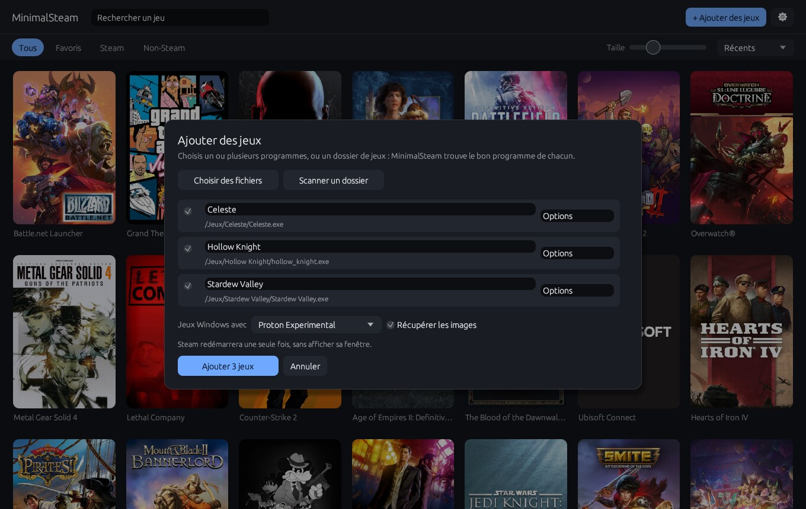

## Personnalisation

- **7 thèmes** : Nuit, Graphite, Océan, Forêt, Aubergine, Braise et Clair.
- **Couleurs libres** pour l'accent, le fond, les panneaux, les cartes, le haut et le texte.
- **Police d'écriture** au choix parmi celles installées sur ton PC.
- **Fond du haut, de la bibliothèque et du panneau du jeu**, réglés séparément (le haut peut aussi être transparent) : une couleur, ton image, l'arrière-plan flouté du jeu sélectionné, celui d'un jeu choisi dans la liste, ou un fond haute définition de SteamGridDB, avec flou et assombrissement réglables. Le haut peut devenir un verre dépoli qui floute les jaquettes passant dessous.
- **Taille des jaquettes** réglable directement depuis la barre d'outils.
- **Arrondi des jaquettes** et affichage ou non des noms.

| Grandes jaquettes | Petites jaquettes |
|---|---|
| 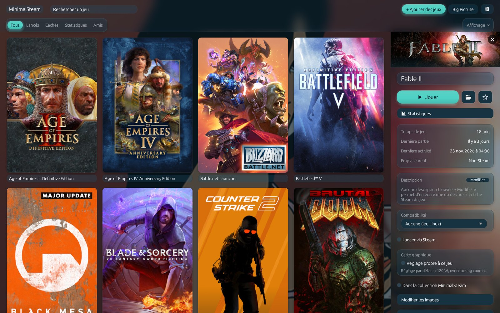 | 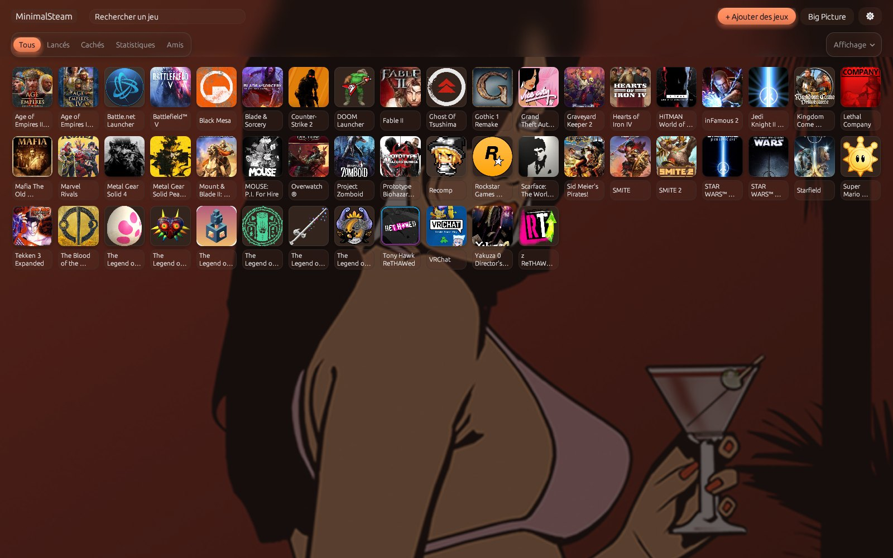 |

| Thème clair | Réglages |
|---|---|
|  |  |

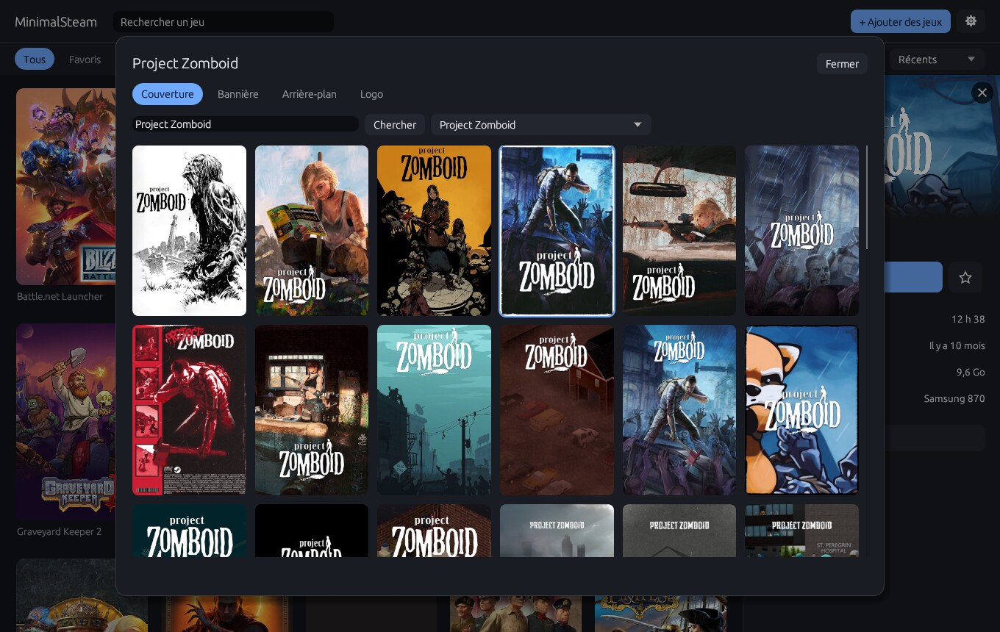

## Installation

1. Télécharge `MinimalSteam-x.y.z-linux-x86_64.AppImage` depuis les [Releases](https://github.com/VGioM/MinimalSteam/releases/latest).
2. Rends-la exécutable (clic droit, Propriétés, « Exécutable », ou `chmod +x MinimalSteam-*.AppImage`), puis lance-la.
3. Pour modifier les images, ajoute une **clé API SteamGridDB** gratuite dans **Réglages, Compte**. Tu peux l'obtenir sur [la page API de SteamGridDB](https://www.steamgriddb.com/profile/preferences/api).
4. Pour l'onglet **Non installés**, ajoute une **clé API Steam** gratuite au même endroit. L'app explique chaque étape.

Steam doit être installé (version native ou Flatpak) et connecté à ton compte. Le lancement sans Steam des jeux Windows demande [umu-launcher](https://github.com/Open-Wine-Components/umu-launcher). Sans lui, ces jeux passent simplement par Steam.

## Raccourcis

Touches d'origine, modifiables dans Réglages > Commandes :

| Action | Clavier / souris | Manette |
|---|---|---|
| Se déplacer | Flèches | Croix ou stick gauche (maintenus : ça défile) |
| Valider, lancer le jeu | Entrée ou double-clic | A |
| Retour, fermer | Échap ou bouton « précédent » de la souris | B |
| Options du jeu (Big Picture) | M | Menu |
| Favori | F | Y |
| Onglet précédent / suivant | Page préc. / Page suiv. | LB / RB |
| Réglages | F10 | X |
| Entrer / sortir du Big Picture | F11 | View |
| Faire défiler | Molette | Stick droit |
| Rechercher | Ctrl+F | |

Dans les réglages et les fenêtres, la manette déplace un cadre de sélection d'un élément à l'autre et A l'active ; LB et RB changent d'onglet de réglages. Sur la fiche d'un jeu en Big Picture, LB et RB passent au jeu précédent ou suivant.

La manette n'agit que quand la fenêtre de MinimalSteam est au premier plan ; hors Big Picture, elle est aussi laissée au jeu tant qu'une partie tourne. Si Steam traduit la manette en touches de clavier, un appui ne compte qu'une fois.

## Comment ça marche

Les **jeux Steam** passent toujours par Steam, nécessaire pour les DRM, Steam Cloud et les succès. S'il est fermé, MinimalSteam le démarre sans fenêtre.

Les **jeux non-Steam** se lancent directement, avec la version de Proton, le préfixe et les options de lancement réglés pour eux. Sans version choisie, ils utilisent Proton Experimental. Si leur version de Proton a été désinstallée, l'app te prévient au lieu de lancer le jeu avec une autre. Sans Steam, ils n'ont ni overlay ni Steam Input, et un anti-triche peut les bloquer : coche **Lancer via Steam** sur leur fiche dans ce cas.

Si Steam a laissé un nom provisoire comme `appid_730` dans le manifeste d'un jeu, MinimalSteam affiche le vrai nom, lu dans le cache de Steam (`appcache/appinfo.vdf`).

L'app ne modifie les fichiers de Steam que pour ajouter, renommer ou supprimer un jeu non-Steam, changer de Proton ou appliquer une icône :

| Fichier | Rôle |
|---|---|
| `userdata/<compte>/config/shortcuts.vdf` | Jeux non-Steam et icônes |
| `config/config.vdf` | Version de Proton des jeux ajoutés |
| `userdata/<compte>/config/grid/` | Images personnalisées |
| `userdata/<compte>/config/cloudstorage/` | Collection MinimalSteam, si tu l'utilises |

Ces écritures se font Steam fermé et **jamais pendant qu'un jeu lancé par Steam tourne**. Tu peux ajouter ou supprimer un jeu, ou changer de Proton, en pleine partie : le changement passe en **file d'attente**, puis Steam redémarre discrètement quelques secondes après la fermeture du dernier jeu. Une copie `*.minimalsteam-sauvegarde` est créée avant la première modification. Les réglages de l'app sont dans `~/.config/Minimalsteam/`.

## Limites

- L'installation d'un jeu Steam se fait toujours dans Steam : MinimalSteam ouvre sa fenêtre d'installation.
- Le temps de jeu sans Steam n'est compté que si MinimalSteam reste ouvert jusqu'à la fermeture du jeu.
- Le temps de jeu jour par jour commence le premier jour d'utilisation de cette version : Steam ne garde pas d'historique avant. Une partie jouée pendant que MinimalSteam était fermé est retrouvée d'après le total de Steam, avec une date approchée.
- MinimalSteam ne gère pas les ROM ni les émulateurs.
- En Big Picture, la recherche se fait au clavier : il n'y a pas encore de clavier à l'écran.
- La souris cachée dans les jeux et les autres logiciels demande KDE Plasma 6.2 ou plus ; ailleurs, elle n'est cachée que dans MinimalSteam. Dans les jeux non-Steam lancés par MinimalSteam, le pointeur du système est carrément invisible (un jeu qui dessine son propre curseur le garde). Dans les jeux lancés par Steam, seul l'effet de KDE agit, et un jeu qui replace lui-même le pointeur en continu peut le garder visible.
- Hors Big Picture, la souris cachée partout l'est tant que MinimalSteam reste ouvert, même en arrière-plan.

## Remplace Biblijeu sur Linux

MinimalSteam prend la suite de la version Linux de [Biblijeu](https://github.com/VGioM/Biblijeu), qui reste une application macOS.

## Compiler

```sh
cargo build --release
```

Il faut Rust et les bibliothèques de développement X11/Wayland habituelles. `./build-appimage.sh` produit l'AppImage (avec `squashfs-tools` et un runtime AppImage).

## Licence

[MIT](LICENSE)
